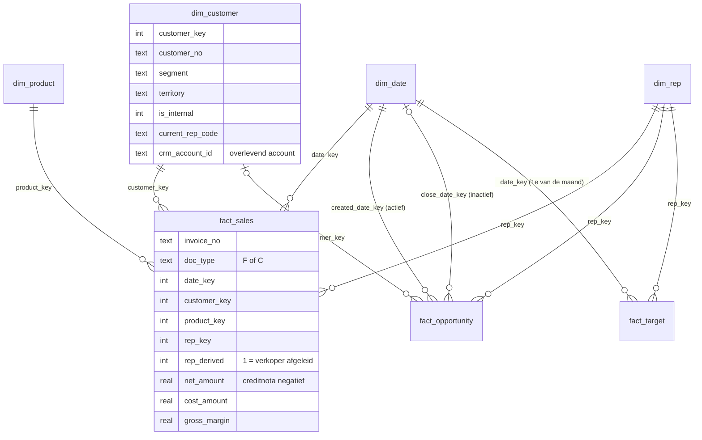

# 03 · Model — een sterschema dat Power BI begrijpt

> Wat is dit: het datamodel van het rapport, met de korrel van elke tabel en de keuzes erachter. Voor wie: wie measures schrijft of het model uitbreidt. Waarom: de meeste "fout cijfer"-meldingen in Power BI komen van een model dat de vraag niet past, niet van een fout in DAX.
> Vorige → [02 · Bronnen](../02-sources/README.md) · Volgende → [04 · Pipeline](../04-pipeline/README.md)

## Het schema

DDL: [`sql/03_model.sql`](../../sql/03_model.sql) (SQLite, voor de demo) en [`sql/tsql/01_schema.sql`](../../sql/tsql/01_schema.sql) (SQL Server, met primaire en vreemde sleutels).

## Korrel per tabel

| Tabel | Eén rij is | Rijen | Waarom deze korrel |
|---|---|---:|---|
| `fact_sales` | één factuur- of creditnotalijn | <!--m:n_invoice_lines|int-->76.144<!--/m--> | laagste niveau dat finance boekt; alles daarboven is optellen |
| `fact_opportunity` | één opportunity, huidige stand | <!--m:n_opportunities|int-->1.649<!--/m--> | sales vraagt "waar staan we nu", niet de historiek van elke fase |
| `fact_target` | één verkoper × maand | <!--m:n_targets|int-->139<!--/m--> | zo levert de sales manager ze aan |
| `dim_customer` | één ERP-klant | <!--m:n_erp_customers_all|int-->1.380<!--/m--> | het ERP is de bron van waarheid voor wie klant is |
| `dim_rep` | één verkoper (+ rij 0 "Niet toegewezen") | 14 | rij 0 vangt wat niet toe te wijzen is, zodat totalen nooit stilletjes verdwijnen |
| `dim_product` | één artikel | <!--m:n_products|int-->385<!--/m--> | categorie leeg → "Onbekend", zichtbaar in plaats van weggefilterd |
| `dim_date` | één dag, 2025–2026 | 730 | gemarkeerd als datumtabel voor vergelijkingen met vorig jaar |

## Keuzes

| Keuze | Alternatief | Waarom zo | Prijs |
|---|---|---|---|
| Sterschema met smalle feiten | één brede tabel met alles | Power BI filtert van dimensie naar feit; één brede tabel geeft dubbele tellingen en trage visuals ([ADR-001](../adr/ADR-001-sterschema.md)) | iets meer joins in SQL |
| Creditnota's als negatieve rijen in `fact_sales` | aparte tabel | `SUM(net_amount)` is meteen de finance-omzet; geen measure kan het vergeten | wie ruwe aantallen wil, filtert op `doc_type` |
| Verkoper op factuurdatum (`rep_key` per lijn) | huidige eigenaar van de klant | omzet van Koen blijft bij Koen, Bram start op nul in april ([ADR-002](../adr/ADR-002-omzet-op-verkoper-van-het-moment.md)) | "wat heeft Bram nu in portefeuille" vraagt `dim_customer.current_rep_code` |
| Lijnen zonder verkoper krijgen de eigenaar op factuurdatum, met vlag `rep_derived` | rij 0 "Niet toegewezen" | <!--m:lines_rep_derived|int-->1.431<!--/m--> lijnen, <!--m:unassigned_revenue_naive|eur0-->€ 774.605<!--/m--> — te veel om te negeren; de vlag houdt het controleerbaar | afleiding moet uitlegbaar blijven: zie measure `[Omzet zonder verkoper (afgeleid)]` |
| Opportunity aan datum via aanmaak (actief) én afsluiting (inactief) | twee datumtabellen | win rate kijkt naar de afsluitdatum, pipeline-instroom naar de aanmaakdatum; `USERELATIONSHIP` wisselt per measure | één measure extra complex |
| Personeelsshop blijft in `fact_sales`, `is_internal = 1` | uit de data filteren | finance boekt ze apart; wie ze zoekt vindt ze; elke omzet-measure sluit ze uit | elke measure moet de filter hebben (centraal in `[Netto-omzet]`) |

## Wat het model niet doet

- Geen historiek van klantsegment of regio (type-2 dimensie). De verkoperswissel is de enige wijziging die het rapport nodig had, en die zit al in de feitenlijnen. Komt er een herindeling van regio's, dan wordt `dim_customer` type 2.
- Geen valuta: alles in euro.
