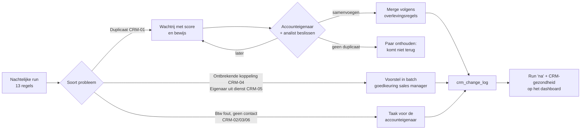

# 05 · CRM-kwaliteit — vinden, beslissen, oplossen, voorkomen

> Wat is dit: hoe het CRM van "klopt niet" naar meetbaar beter gaat, zonder dat iemand records blind verwijdert. Voor wie: sales manager, accounteigenaars, data analyst. Waarom: de vacature vraagt "datakwaliteit bewaken en slimme workflows opzetten" — dit is die workflow.
> Vorige → [04 · Pipeline](../04-pipeline/README.md) · Volgende → [06 · Rapportering](../06-reporting/README.md)

## Resultaat (gesimuleerd)

| | Vóór | Na |
|---|---:|---:|
| CRM-gezondheid (klantaccounts zonder blokkerend probleem) | <!--m:dq_health_before|pct-->75,0 %<!--/m--> | <!--m:dq_health_after|pct-->98,0 %<!--/m--> |
| Meldingen over alle regels | <!--m:dq_issues_before|int-->2.346<!--/m--> | <!--m:dq_issues_after|int-->522<!--/m--> |
| Duplicaatparen in de wachtrij | <!--m:dup_pairs_before|int-->165<!--/m--> | <!--m:dup_pairs_after|int-->5<!--/m--> (bewust uitgesteld) |
| Actieve CRM-accounts | <!--m:n_crm_accounts|int-->1.705<!--/m--> | <!--m:accounts_after_merge|int-->1.569<!--/m--> |

Wat er níet opgelost is, en waarom: de <!--m:rule_crm02_after|int-->23<!--/m--> foute btw-nummers en <!--m:rule_crm06_after|int-->74<!--/m--> accounts zonder contactgegevens vragen informatie van de klant zelf. Die staan op de takenlijst van de accounteigenaar, niet in een script.

## De workflow

Drie soorten oplossing, omdat drie soorten problemen een andere beslisser hebben:

| Soort | Regels | Wie beslist | Hoe |
|---|---|---|---|
| **Beoordelen** — een mens weet iets wat de data niet weet | CRM-01 | accounteigenaar, met de analist | duplicatenwachtrij, één klik per paar, met bewijs |
| **Regel + goedkeuring** — eenduidig, maar met gevolgen | CRM-04, CRM-05 | sales manager keurt de batch goed | voorstel van de analist, gelogd |
| **Navragen** — informatie ontbreekt | CRM-02, CRM-03, CRM-06, OPP-01/02/03 | accounteigenaar | taak in het CRM met deadline |

Het model lost ERP-01 zelf op (verkoper op factuurdatum, [03 · Model](../03-modelling/README.md)). ERP-02 en ERP-03 horen bij aankoop: de analist meldt, aankoop corrigeert de artikelfiche.

## De onderdelen

- [Regels](rules.md) — alle 13 regels met ernst, eigenaar, aantallen vóór/na en de SQL.
- [Duplicaten](duplicates.md) — hoe paren gevonden en gescoord worden, de overlevingsregels, en waarom niets automatisch samenvoegt.
- Beslissingen van de review: [`data/review/decisions.csv`](../../data/review/decisions.csv) · wachtrij: [`data/review/duplicate_queue.csv`](../../data/review/duplicate_queue.csv).
- In de demo: tab **CRM-kwaliteit** — beslis zelf over de paren en zie de score bewegen.

## Voorkomen in plaats van opkuisen

Opkuisen zonder de bron te dichten is volgende maand opnieuw beginnen. Daarom drie preventieve maatregelen in het [verbeterplan](../10-improvement/README.md):

1. **Btw-nummer verplicht en gevalideerd bij aanmaak van een klantaccount** (mod 97 / Franse sleutel) — voorkomt CRM-02 en maakt duplicaatdetectie veel sterker.
2. **Duplicaatcontrole bij invoer**: het CRM toont bestaande accounts met dezelfde btw of een gelijkaardige naam in dezelfde gemeente vóór "opslaan".
3. **Vertrek van een verkoper = checklist** met "accounts overzetten" als stap van HR en de sales manager, niet iets wat het rapport drie maanden later ontdekt.
